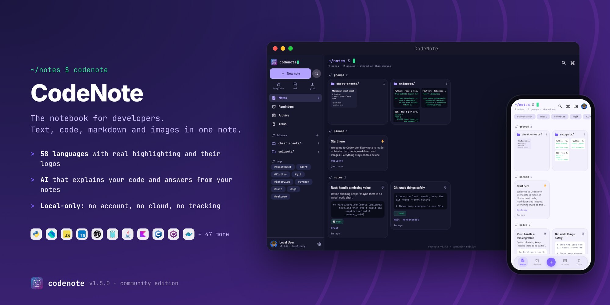
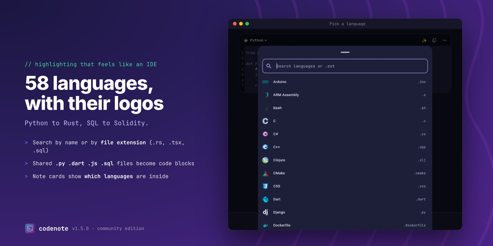
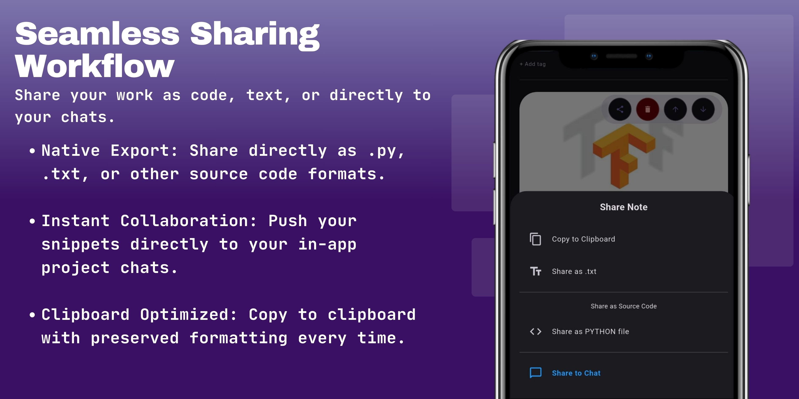
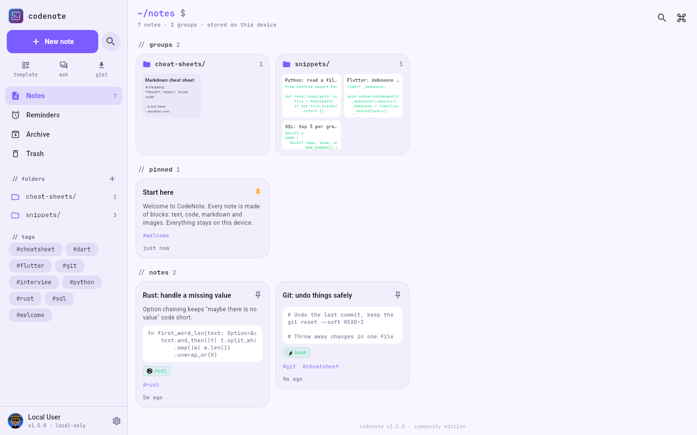
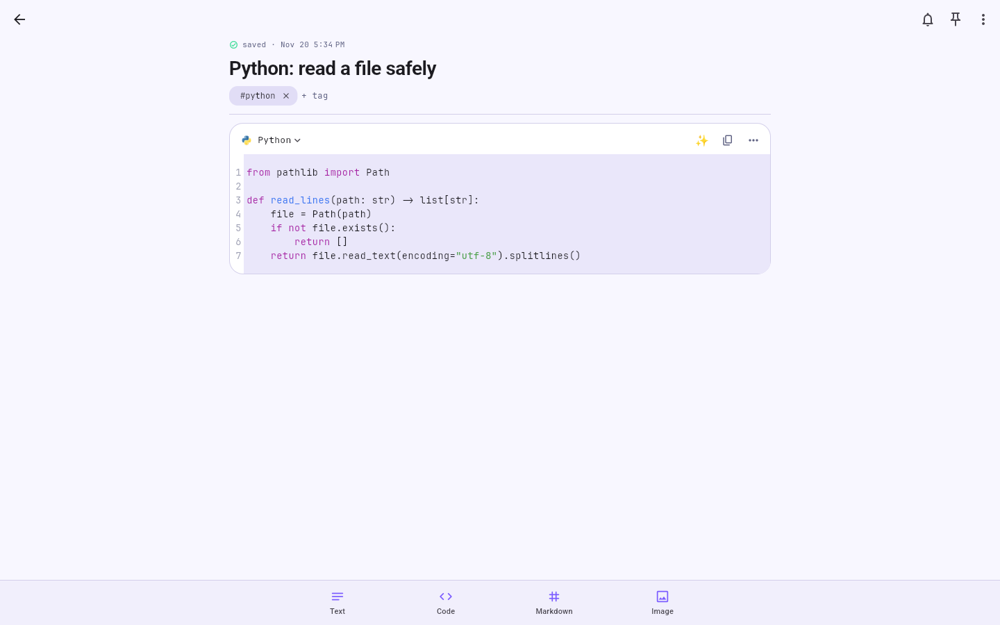

# CodeNote

[](https://github.com/mahmoudyosrimahmoud13/code_note/actions/workflows/build.yml)
[](LICENSE)

**🌐 Website: [mahmoudyosrimahmoud13.github.io/code_note](https://mahmoudyosrimahmoud13.github.io/code_note/)**

**A notebook for code, notes and ideas, and now a chat for developers.** Mix text, code, markdown and images in one note, run your code, and send notes and code to other developers. On Android, Windows, Linux and macOS.

```
~/notes $ ls
flutter/   python/   📌 deploy-checklist   #sql #interview   💬 chats
```

<p align="center">
  
</p>

## Two editions, both free

| | **CodeNote Local** | **CodeNote Online** |
|---|---|---|
| Notes, code blocks, running code, AI, templates | ✓ | ✓ |
| Works offline, no account | ✓ | ✓ (sign in when you want) |
| Chats and groups with other developers | | ✓ |
| Send notes and code in a chat | | ✓ |
| Notes synced across your devices | | ✓ |
| Push notifications | | ✓ |
| Version | 1.x | 2.x |

**Download:** pick your edition on the **[website](https://mahmoudyosrimahmoud13.github.io/code_note/#download)**, or get the files from **[Releases](https://github.com/mahmoudyosrimahmoud13/code_note/releases)**: `CodeNote-1.x-…` is Local, `CodeNote-Online-2.x-…` is Online. The two install side by side, so you can keep both.


## CodeNote Online

Everything Local does, plus:

- **Chat** with other developers: direct chats and groups, replies, reactions, edits, pins, read ticks, typing and online status, photos.
- **Send notes and code blocks** in a chat. They arrive as cards with **Preview**, **Copy** and **Save to my notes**, so code is ready to run on the other side.
- **Groups** with admins, "only admins can send", members, descriptions and pictures.
- **Find people** by name, @username or email, or by **QR code**.
- **Notes sync**: your notes and folders are the same on every device you sign in on.
- **Push notifications** when the app is closed (Android, iPhone, Mac).
- **Admin dashboard**: numbers, people (turn accounts off, make admins), sign-up switch and limit, announcements to everyone.
- **Email and password or Google sign-in**, email codes, password reset.

Notes still live on your device first: the app works offline, and you can use it without an account ("Use CodeNote without an account for now").

### Run it on your own server

Online comes as **two builds from the same code**:

| Build | Backend | Setup |
|---|---|---|
| **CodeNote Online** | Supabase (ready to use) | [docs/online/SUPABASE.md](docs/online/SUPABASE.md) |
| **CodeNote Server** | Your own FastAPI server (`server/`). The app asks for its address the first time | [docs/online/SERVER.md](docs/online/SERVER.md) |

Building, secrets, push and Google sign-in: [docs/online/BUILD.md](docs/online/BUILD.md). How both backends behave the same: [docs/online/CONTRACT.md](docs/online/CONTRACT.md).

---

## Features

### Notes made of blocks

<p align="center"></p>

- **Text, code, markdown and image blocks** in any order, in one note. Drag the handle to reorder them.
- **Code blocks** with highlighting for **58 languages**, each with its logo, plus line numbers and the JetBrains Mono font. Search the language list by name or by file extension.
- **Run HTML, CSS and JS** right from a note with the ▶ button.
- **A symbol bar** while you type code: `{}` `()` `[]` `""` `;` `=>` and an indent key, inserted where your cursor is.
- **Markdown** with a live preview. Tap to edit, tap away to see it rendered.
- **Link previews** *(new in 1.11.0)*: links in text blocks are highlighted and get a card with the page's picture, title and site. Tap it to open, long-press to copy. Note cards on the home screen show it too. Turn it off in **Settings → Links** and CodeNote never contacts the sites.
- **Scan text from a photo** (Android and iOS): take a photo or pick one, check the text, and add it as a text block or a code block in the right language.

### Run code, safely sandboxed

- **▶ Run** Python, Bash, PowerShell, JavaScript and TypeScript (Node.js) and Dart blocks. Output shows under the code. Save it into the note with one tap.
- **Python like Jupyter:** blocks in a note share variables, the last line shows its value, and plots, pandas tables and any library's rich output show right under the code (matplotlib, seaborn, plotly, Pillow, PyTorch, tqdm progress bars).
- **Sequences.** A note runs its blocks top to bottom, and a folder runs its notes in an order you set. The **★ primary** one always runs last and keeps running.
- **One sandbox per folder.** Notes in a folder share it, so a FastAPI backend in one note and its web page in another work together. Press **▶ Run folder** to start everything.
  - **Android:** Android's own app sandbox.
  - **macOS:** Apple's App Sandbox.
  - **Linux:** bubblewrap. Scripts can't see your home folder.
  - **Windows:** a private folder only, so running code is off until you allow it.
- **Files stay in the sandbox** until you press **Save a copy**.
- **Built-in terminal**, and **Settings → Runtimes and sandbox** to download Python, Node.js, Dart or Bash from their official sources and to install or update Python and npm packages.
- **Share as `.codenote`:** one note, a folder or everything in one file, with images and app data. Double-click a `.codenote` file to open it.
- **Mini apps:** web page notes can save data (`localStorage` just works). Try the **Snake** game, the **youtube-downloader** folder (yt-dlp with all the options) and **fastapi-todo**.
- **Open Jupyter notebooks** *(new in 1.9.0)*: open an `.ipynb` from Jupyter, Colab or Kaggle and it becomes a note. Markdown cells become Markdown blocks, code cells become code blocks, and saved outputs and plots come along. Use **Ctrl+K → Open a Jupyter notebook**, or "Open with" from your file manager.
- **Jupyter keyboard shortcuts** *(new in 1.9.0)*: **Shift+Enter** runs and moves to the next block, **Ctrl+Enter** runs and stays, **Alt+Enter** runs and adds a block below. **Esc** selects the block, then **A / B** add a block above or below, **D D** deletes, **M** makes it Markdown, **I I** stops the code and **0 0** restarts the kernel.
- **Expose sandbox** *(new in 1.9.0)*: off by default. When you trust the code, let it read and change your own files (Linux, Windows). Plus **Open the sandbox folder** in your file manager.

### Data science in your pocket

- **Python on your phone** *(new in 1.9.0)*: the same Jupyter-style kernel as on computers, running in CodeNote's sandbox with Pyodide. Download Python and the data science set (numpy, pandas, matplotlib, seaborn, scipy, scikit-learn) once from **Settings → Runtimes and sandbox**, then it works offline.
- **Workspaces** *(new in 1.9.0)*: open a folder (computer) or files (phone) like a small IDE. Open each file as a file (edit, run) or as a note (`.ipynb` cells, `.py` split at `# %%`), and **Save back** to the original folder.
- **Data viewer** *(new in 1.9.0)*: CSV, TSV and JSON as a table you can search and sort, a summary of every column, a chart per column, and **Analyze in a notebook** to get the pandas code written for you.
- **Snippets and export** *(new in 1.9.0)*: insert ready-made pandas, chart and scikit-learn code; export a note as `.ipynb` or as an HTML report.

### Works with inPace

- **Practice in CodeNote** *(new in 1.10.0)*: in [inPace](https://mahmoudyosrimahmoud13.github.io/inPace/), lessons with code open in CodeNote with one tap, as a note you can run. Practical tasks come with their prompt. **Export for inPace** makes an HTML report of your work to attach to the task, and **Back to inPace** takes you to the lesson.
- Any `.md` file opens as a note with runnable code blocks.

### Start from a template

<p align="center"></p>

- **Bug report, daily dev log, LeetCode problem, meeting notes, API endpoint, snippet with notes.**
- Today's date is filled in for you.
- **Save any note as a template** from its ⋯ menu.

### AI that respects your privacy

<p align="center"></p>

- **✨ Explain code, find bugs, suggest improvements** on any code block, and **save the answer into the note**.

<p align="center"></p>

- **Ask your notes:** ask a question in plain words and get an answer from your own notes, with links to the notes it used. Save the answer as a note.

<p align="center"></p>

- Use **Claude**, any **OpenAI-compatible** API, or run fully offline with **Ollama** or **LM Studio**. CodeNote **finds your local models automatically**.
- Off until you set it up. Only what you ask about is sent, and your key never leaves the device.

### Built for developers

<p align="center"></p>

- **Command palette (Ctrl+K):** every action, note and folder from the keyboard. Plus **Ctrl+N** new note and **Ctrl+F** search.
- **GitHub Gist:** import any gist as a note, or upload a note as a gist and get the link.
- **Share code as an image** with nice backgrounds, ready for X, LinkedIn or Discord.
- **Share into CodeNote** on Android: share text, a link, a photo or a code file from any app. Files like `.py`, `.dart`, `.js`, `.sql` become code blocks with the right language. `.md` becomes markdown.
- **Open with CodeNote** for source files from your file manager.
- **Share out** a note as text, as a `.txt`, or as a source file (`.py`, `.dart`, ...).

### Organized your way

<p align="center"></p>

- **Folders that show what's inside:** each folder card previews its notes, code and images.
- **Tags**, with one-tap tag filters. On wide screens, a **sidebar** with your folders and tags.
- **Pin** important notes to the top. **Archive** what you don't need every day.
- **Search** across titles, tags, text and code.
- **Reminders** that pop up as real notifications.
- **Trash** keeps deleted notes for 30 days, then removes them and their images for good. Every swipe has **Undo**.
- **Light, dark or system theme**, and adjustable text size.

### Your notes are safe
- **Backup and restore:** every note, folder and image in one `.codenote` file. Restoring merges and never deletes.
- **Daily backup to a folder** (Windows, Linux): point it at Dropbox, Google Drive, Syncthing or a Git repo to sync between computers.
- **Update check:** you hear about new versions, and can turn it off.

### Screenshots

<p align="center">
  
  
</p>
<p align="center">
  
  
</p>
<p align="center">
  
  
</p>

---

## What's new

See **[CHANGELOG.md](CHANGELOG.md)** for every version. Highlights of 1.8.0: Python works like Jupyter (shared variables, plots, tables and rich output from any library), a pandas cookbook and PyTorch demo, and a fix for the Linux sandbox.

**New in 1.9.0, data science in your pocket:** Python on phones (same Jupyter-style kernel, packages downloaded from Settings), **workspaces** that open a folder like an IDE, a **data viewer** for CSV and JSON with stats and charts, data science **snippets**, export to **.ipynb** or an **HTML report**, plus Jupyter notebooks as notes, Jupyter keyboard shortcuts and an **Expose sandbox** setting.

---

## Build it yourself

You need **Flutter 3.41.9** (the version this project is pinned to; newer Flutter needs a Gradle 9 upgrade first). For Android you also need **JDK 17**.

```bash
git clone git@github.com:mahmoudyosrimahmoud13/code_note.git
cd code_note
flutter pub get
flutter test                    # run the tests
flutter run                     # run on a connected device or desktop
flutter build apk --release     # Android
flutter build windows --release # Windows (on Windows)
flutter build linux --release   # Linux (needs: ninja-build libgtk-3-dev clang cmake pkg-config)
flutter build macos --release   # macOS (on a Mac with Xcode)
```

### Version numbers

`pubspec.yaml` holds the version, for example `version: 1.2.0+10200`.

- The part before `+` is the version people see.
- The part after `+` is Android's version code. It must always go up, or phones refuse the update. The rule is **major × 10000 + minor × 100 + patch**, so 1.2.0 is `10200`, 1.2.1 is `10201` and 1.3.0 is `10300`.
- `lib/constants/app_info.dart` shows the version in the app and must match.

The build checks all three and stops with a clear message if they don't match.

### Releasing

1. Update the version in `pubspec.yaml` and `lib/constants/app_info.dart`.
2. Add a `## [x.y.z]` section to `CHANGELOG.md`. It becomes the release notes (the build stops if it's missing).
3. Commit, then tag and push: `git tag vX.Y.Z && git push origin vX.Y.Z`.
4. GitHub Actions builds all platforms and publishes the release with install steps, all files and `SHA256SUMS.txt`.

### Android signing (once, by the maintainer)

Android only installs an update over an existing app when it's **signed with the same key**. Release builds read the key from four repository secrets (**Settings > Secrets and variables > Actions**):

| Secret | Value |
| --- | --- |
| `ANDROID_KEYSTORE_BASE64` | The keystore file, base64-encoded |
| `ANDROID_KEYSTORE_PASSWORD` | Keystore password |
| `ANDROID_KEY_ALIAS` | Key alias |
| `ANDROID_KEY_PASSWORD` | Key password |

A tagged release fails if the key is missing, so an unsigned APK can never be published by mistake. For local release builds, put the same values in `android/key.properties` (`storeFile`, `storePassword`, `keyAlias`, `keyPassword`). That file is git-ignored.

---

## Architecture

Clean Architecture with three layers per feature (`data`, `domain`, `presentation`):

- **State:** BLoC. Each bloc listens to storage once and screens filter what they show.
- **Storage:** Hive. Every note and group is its own entry (`note:<id>`, `group:<id>`) with an in-memory copy, so saving one note writes only that note. Older data is moved to this format automatically on first launch.
- **Dependency injection:** GetIt.
- **Design system:** `lib/constants/themes.dart` (colors from the logo, surfaces, type, code colors) and `lib/widgets/brand.dart` (prompt line, blinking cursor, comment labels, terminal empty states).

More detail in **[PROJECT_OVERVIEW.md](PROJECT_OVERVIEW.md)**.

---

## Contributing

Issues and pull requests are welcome. Every pull request is checked by the build: analysis, tests, and builds for all four platforms.

## License

Language logos come from [Devicon](https://devicon.dev) (MIT license).


GNU Affero General Public License v3.0. See [LICENSE](LICENSE). JetBrains Mono is under the SIL Open Font License (`assets/fonts/JetBrainsMono-OFL.txt`).
