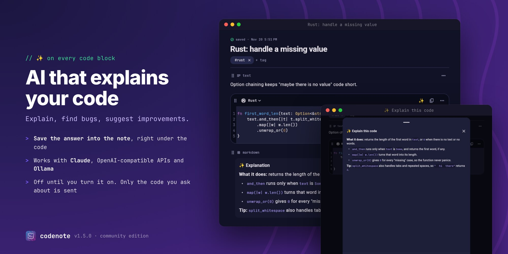

# CodeNote

[](https://github.com/mahmoudyosrimahmoud13/code_note/actions/workflows/build.yml)
[](LICENSE)

**A notebook for code, notes and ideas.** Mix text, code, markdown and images in one note, with real syntax highlighting and a code font, on Android, Windows, Linux and macOS.

```
~/notes $ ls
flutter/   python/   📌 deploy-checklist   #sql #interview
```

<p align="center">
  
</p>

> [!IMPORTANT]
> **This repository is the Community Edition: local-only.** Your notes stay on your device. There is no account, no cloud and no tracking. The full version with cloud sync and messaging is distributed separately (see Download).

---

## Download

**Community Edition (local-only)**, the version built from this code:

Get the latest build for your platform from **[Releases](https://github.com/mahmoudyosrimahmoud13/code_note/releases/latest)**:

| Platform | File |
| --- | --- |
| Android | `CodeNote-<version>-android.apk` (works on every phone, Android 7.0+) |
| Windows | `CodeNote-<version>-windows-x64.zip` (unzip, run `code_note.exe`) |
| Ubuntu, Debian, Mint, Zorin | `CodeNote-<version>-linux-amd64.deb`: install with `sudo apt install ./CodeNote-<version>-linux-amd64.deb`, then open CodeNote from the app menu or run `codenote` |
| Other Linux | `CodeNote-<version>-linux-x64.tar.gz` (extract, run `./code_note`) |
| macOS | `CodeNote-<version>-macos.zip` (unzip, then right-click the app > Open the first time, because it isn't notarized) |

**Updating on Android:** install the new APK over the old one. Your notes stay. Starting with 1.2.0, every release is signed with the same key and has a higher version number, so Android accepts it as an update.

**Full version** (cloud sync and messaging):
[Android](https://github.com/mahmoudyosrimahmoud13/code_note/releases/download/Professional/app-release.apk) ·
[Windows](https://github.com/mahmoudyosrimahmoud13/code_note/releases/download/Professional/Release.zip)

---

## Features

### Notes made of blocks
- **Text, code, markdown and image blocks** in any order, in one note.
- **Code blocks** with highlighting for 20+ languages (Python, Dart, JavaScript, TypeScript, Go, Java, Kotlin, C#, C++, PHP, SQL, PostgreSQL, Bash, HTML, CSS, JSON, Docker, Django, Arduino, ARM and x86 assembly), line numbers and the JetBrains Mono font.
- **A symbol bar** while you type code: `{}` `()` `[]` `""` `;` `=>` and an indent key, inserted where your cursor is.
- **Markdown** with a live preview. Tap to edit, tap away to see it rendered.
- **Scan text from a photo** (Android and iOS) and drop it in as a text or code block.

### Organized your way
- **Groups** (folders). Drag a note onto a group to move it there.
- **Tags**, with one-tap tag filters on the home screen.
- **Pin** important notes to the top. **Archive** what you don't need every day.
- **Search** across titles, tags, text and code.
- **Trash** keeps deleted notes for 30 days, then removes them and their images for good. Every swipe has **Undo**.
- **Reminders** list for notes you need to come back to.

### Built for developers
- **Share into CodeNote** on Android: share text, a link, a photo or a code file from any app. Files like `.py`, `.dart`, `.js`, `.sql` become code blocks with the right language. `.md` becomes markdown.
- **Open with CodeNote** for source files from your file manager.
- **Share out** a note as text, as a `.txt`, or as a source file (`.py`, `.dart`, ...).
- **Light, dark or system theme**, and adjustable text size.

<p align="center">
  
  
  
</p>

---

## What's new in 1.2.0

- **Faster:** each note is saved on its own instead of rewriting every note on each keystroke, and the app no longer slows down the longer it runs.
- **No lost edits:** your last keystrokes are saved when you leave a note, and archiving or trashing from inside a note keeps your latest changes.
- **Delete forever actually deletes** (it used to only move the note to the trash again). Trash empties itself after 30 days.
- **Shared items are saved right away**, shared photos are no longer ignored, and `.md` and `.txt` files open as text.
- **New look with a terminal personality:** prompt-style headers, `// comment` section labels, code previews on cards, a real code font, quieter block controls (one `⋯` menu instead of a row of big buttons), labeled toolbar, new onboarding.
- **Accessible:** every icon button has a label for screen readers and a tooltip.
- **Builds for Android, Windows, Linux (.deb and .tar.gz) and macOS** on every push, with signed Android releases that update cleanly.

---

## Build it yourself

You need **Flutter 3.41.9** (the version this project is pinned to; newer Flutter needs a Gradle 9 upgrade first). For Android you also need **JDK 17**.

```bash
git clone git@github.com:mahmoudyosrimahmoud13/code_note.git
cd code_note
flutter pub get
flutter test                    # run the tests
flutter run                     # run on a connected device or desktop
flutter build apk --release     # Android
flutter build windows --release # Windows (on Windows)
flutter build linux --release   # Linux (needs: ninja-build libgtk-3-dev clang cmake pkg-config)
flutter build macos --release   # macOS (on a Mac with Xcode)
```

### Version numbers

`pubspec.yaml` holds the version, for example `version: 1.2.0+10200`.

- The part before `+` is the version people see.
- The part after `+` is Android's version code. It must always go up, or phones refuse the update. The rule is **major × 10000 + minor × 100 + patch**, so 1.2.0 is `10200`, 1.2.1 is `10201` and 1.3.0 is `10300`.
- `lib/constants/app_info.dart` shows the version in the app and must match.

The build checks all three and stops with a clear message if they don't match.

### Releasing

1. Update the version in `pubspec.yaml` and `lib/constants/app_info.dart`.
2. Commit, then tag and push: `git tag v1.2.0 && git push --tags`.
3. GitHub Actions builds all four platforms and publishes a release with the files.

### Android signing (once, by the maintainer)

Android only installs an update over an existing app when it's **signed with the same key**. Release builds read the key from four repository secrets (**Settings > Secrets and variables > Actions**):

| Secret | Value |
| --- | --- |
| `ANDROID_KEYSTORE_BASE64` | The keystore file, base64-encoded |
| `ANDROID_KEYSTORE_PASSWORD` | Keystore password |
| `ANDROID_KEY_ALIAS` | Key alias |
| `ANDROID_KEY_PASSWORD` | Key password |

A tagged release fails if the key is missing, so an unsigned APK can never be published by mistake. For local release builds, put the same values in `android/key.properties` (`storeFile`, `storePassword`, `keyAlias`, `keyPassword`). That file is git-ignored.

---

## Architecture

Clean Architecture with three layers per feature (`data`, `domain`, `presentation`):

- **State:** BLoC. Each bloc listens to storage once and screens filter what they show.
- **Storage:** Hive. Every note and group is its own entry (`note:<id>`, `group:<id>`) with an in-memory copy, so saving one note writes only that note. Older data is moved to this format automatically on first launch.
- **Dependency injection:** GetIt.
- **Design system:** `lib/constants/themes.dart` (colors from the logo, surfaces, type, code colors) and `lib/widgets/brand.dart` (prompt line, blinking cursor, comment labels, terminal empty states).

More detail in **[PROJECT_OVERVIEW.md](PROJECT_OVERVIEW.md)**.

---

## Contributing

Issues and pull requests are welcome. Every pull request is checked by the build: analysis, tests, and builds for all four platforms.

## License

GNU Affero General Public License v3.0. See [LICENSE](LICENSE). JetBrains Mono is under the SIL Open Font License (`assets/fonts/JetBrainsMono-OFL.txt`).
