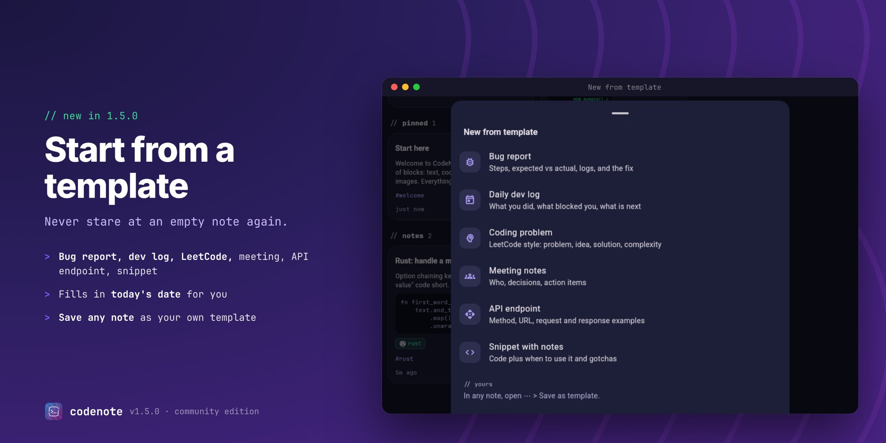
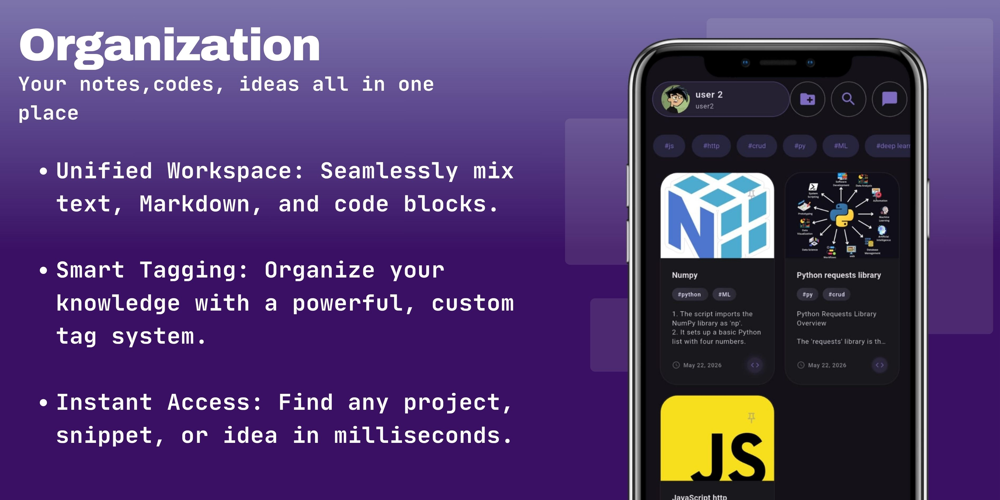
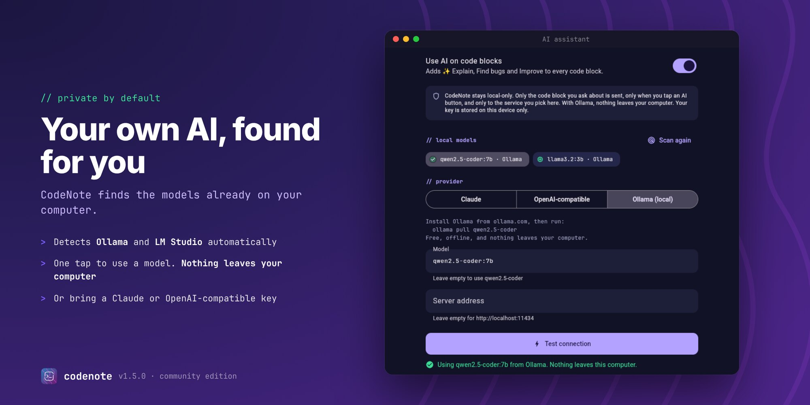
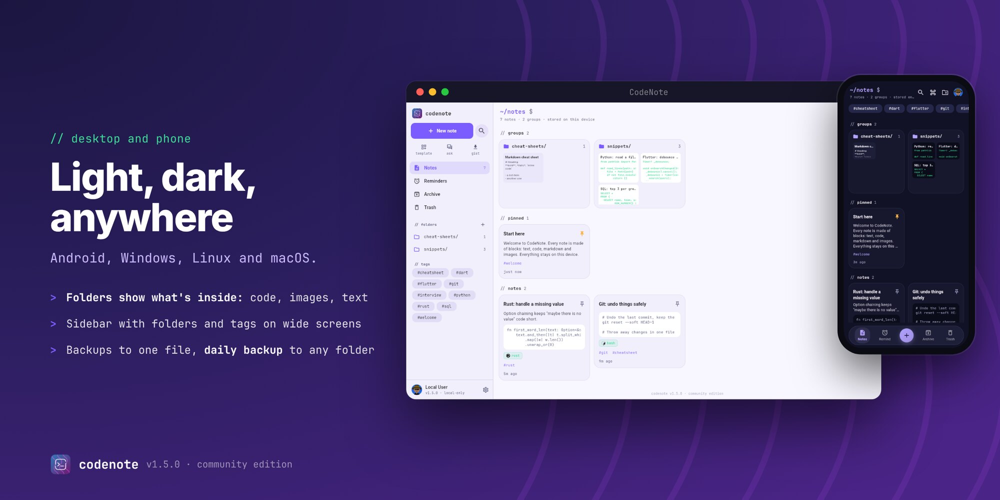
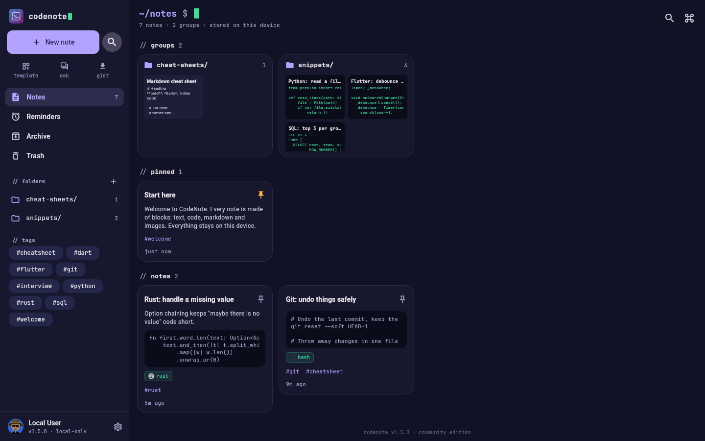
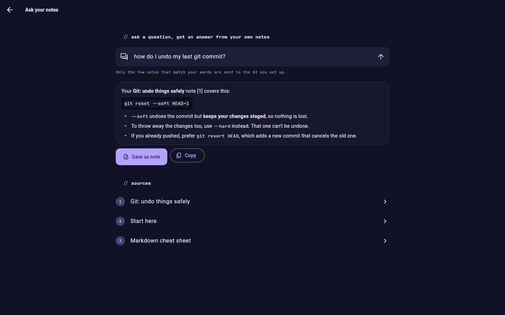
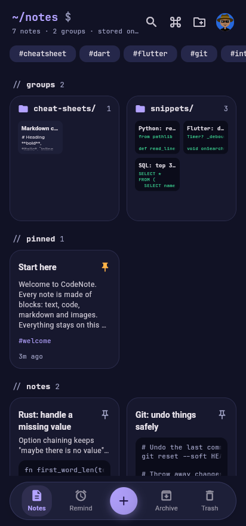
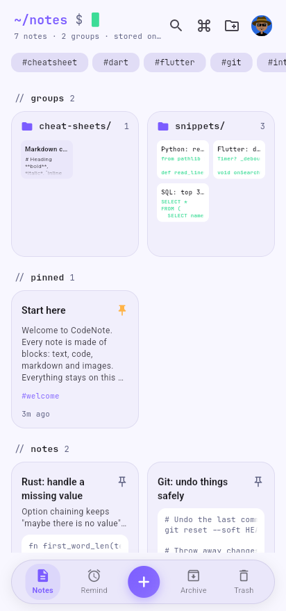

# CodeNote

[](https://github.com/mahmoudyosrimahmoud13/code_note/actions/workflows/build.yml)
[](LICENSE)

**🌐 Website: [mahmoudyosrimahmoud13.github.io/code_note](https://mahmoudyosrimahmoud13.github.io/code_note/)**

**A notebook for code, notes and ideas.** Mix text, code, markdown and images in one note, with real syntax highlighting and a code font, on Android, Windows, Linux and macOS.

```
~/notes $ ls
flutter/   python/   📌 deploy-checklist   #sql #interview
```

<p align="center">
  
</p>

> [!IMPORTANT]
> **This repository is the Community Edition: local-only.** Your notes stay on your device. There is no account, no cloud and no tracking. The full version with cloud sync and messaging is distributed separately (see Download).

---

## Download

**Community Edition (local-only)**, the version built from this code:

Get the latest build for your platform from **[Releases](https://github.com/mahmoudyosrimahmoud13/code_note/releases/latest)**:

| Platform | File |
| --- | --- |
| Android | `CodeNote-<version>-android.apk` (works on every phone, Android 7.0+) |
| Windows | `CodeNote-<version>-windows-x64.zip` (unzip, run `code_note.exe`) |
| Ubuntu, Debian, Mint, Zorin | `CodeNote-<version>-linux-amd64.deb`: install with `sudo apt install ./CodeNote-<version>-linux-amd64.deb`, then open CodeNote from the app menu or run `codenote` |
| Other Linux | `CodeNote-<version>-linux-x64.tar.gz` (extract, run `./code_note`) |
| macOS | `CodeNote-<version>-macos.zip` (unzip, then right-click the app > Open the first time, because it isn't notarized) |

**Updating on Android:** install the new APK over the old one. Your notes stay. Starting with 1.2.0, every release is signed with the same key and has a higher version number, so Android accepts it as an update.

**Full version** (cloud sync and messaging):
[Android](https://github.com/mahmoudyosrimahmoud13/code_note/releases/download/Professional/app-release.apk) ·
[Windows](https://github.com/mahmoudyosrimahmoud13/code_note/releases/download/Professional/Release.zip)

---

## Features

### Notes made of blocks

<p align="center"></p>

- **Text, code, markdown and image blocks** in any order, in one note. Drag the handle to reorder them.
- **Code blocks** with highlighting for **58 languages**, each with its logo, plus line numbers and the JetBrains Mono font. Search the language list by name or by file extension.
- **Run HTML, CSS and JS** right from a note with the ▶ button.
- **A symbol bar** while you type code: `{}` `()` `[]` `""` `;` `=>` and an indent key, inserted where your cursor is.
- **Markdown** with a live preview. Tap to edit, tap away to see it rendered.
- **Scan text from a photo** (Android and iOS) and drop it in as a text or code block.

### Run code, safely sandboxed

- **▶ Run** Python, Bash and PowerShell blocks. Output shows under the code. Save it into the note with one tap.
- **One sandbox per folder.** Notes in a folder share it, so a FastAPI backend in one note and its web page in another work together. Press **▶ Run folder** to start everything.
  - **Android:** Android's own app sandbox.
  - **macOS:** Apple's App Sandbox.
  - **Linux:** bubblewrap. Scripts can't see your home folder.
  - **Windows:** a private folder only, so running code is off until you allow it.
- **Files stay in the sandbox** until you press **Save a copy**.
- **Built-in terminal**, and **Settings → Runtimes and sandbox** to download Python or Bash from their official sources and to install or update Python packages.
- **Mini apps:** web page notes can save data (`localStorage` just works). Try the **Snake** game, the **youtube-downloader** folder (yt-dlp with all the options) and **fastapi-todo**.

### Start from a template

<p align="center"></p>

- **Bug report, daily dev log, LeetCode problem, meeting notes, API endpoint, snippet with notes.**
- Today's date is filled in for you.
- **Save any note as a template** from its ⋯ menu.

### AI that respects your privacy

<p align="center"></p>

- **✨ Explain code, find bugs, suggest improvements** on any code block, and **save the answer into the note**.

<p align="center"></p>

- **Ask your notes:** ask a question in plain words and get an answer from your own notes, with links to the notes it used. Save the answer as a note.

<p align="center"></p>

- Use **Claude**, any **OpenAI-compatible** API, or run fully offline with **Ollama** or **LM Studio**. CodeNote **finds your local models automatically**.
- Off until you set it up. Only what you ask about is sent, and your key never leaves the device.

### Built for developers

<p align="center"></p>

- **Command palette (Ctrl+K):** every action, note and folder from the keyboard. Plus **Ctrl+N** new note and **Ctrl+F** search.
- **GitHub Gist:** import any gist as a note, or upload a note as a gist and get the link.
- **Share code as an image** with nice backgrounds, ready for X, LinkedIn or Discord.
- **Share into CodeNote** on Android: share text, a link, a photo or a code file from any app. Files like `.py`, `.dart`, `.js`, `.sql` become code blocks with the right language. `.md` becomes markdown.
- **Open with CodeNote** for source files from your file manager.
- **Share out** a note as text, as a `.txt`, or as a source file (`.py`, `.dart`, ...).

### Organized your way

<p align="center"></p>

- **Folders that show what's inside:** each folder card previews its notes, code and images.
- **Tags**, with one-tap tag filters. On wide screens, a **sidebar** with your folders and tags.
- **Pin** important notes to the top. **Archive** what you don't need every day.
- **Search** across titles, tags, text and code.
- **Reminders** that pop up as real notifications.
- **Trash** keeps deleted notes for 30 days, then removes them and their images for good. Every swipe has **Undo**.
- **Light, dark or system theme**, and adjustable text size.

### Your notes are safe
- **Backup and restore:** every note, folder and image in one `.codenote` file. Restoring merges and never deletes.
- **Daily backup to a folder** (Windows, Linux): point it at Dropbox, Google Drive, Syncthing or a Git repo to sync between computers.
- **Update check:** you hear about new versions, and can turn it off.

### Screenshots

<p align="center">
  
  
</p>
<p align="center">
  
  
</p>
<p align="center">
  
  
</p>

---

## What's new

See **[CHANGELOG.md](CHANGELOG.md)** for every version. Highlights of 1.6.0: run Python and Bash in a sandbox (one per folder), ▶ Run folder, a built-in terminal, Python packages in Settings, mini apps that save data, and a YouTube downloader demo.

---

## Build it yourself

You need **Flutter 3.41.9** (the version this project is pinned to; newer Flutter needs a Gradle 9 upgrade first). For Android you also need **JDK 17**.

```bash
git clone git@github.com:mahmoudyosrimahmoud13/code_note.git
cd code_note
flutter pub get
flutter test                    # run the tests
flutter run                     # run on a connected device or desktop
flutter build apk --release     # Android
flutter build windows --release # Windows (on Windows)
flutter build linux --release   # Linux (needs: ninja-build libgtk-3-dev clang cmake pkg-config)
flutter build macos --release   # macOS (on a Mac with Xcode)
```

### Version numbers

`pubspec.yaml` holds the version, for example `version: 1.2.0+10200`.

- The part before `+` is the version people see.
- The part after `+` is Android's version code. It must always go up, or phones refuse the update. The rule is **major × 10000 + minor × 100 + patch**, so 1.2.0 is `10200`, 1.2.1 is `10201` and 1.3.0 is `10300`.
- `lib/constants/app_info.dart` shows the version in the app and must match.

The build checks all three and stops with a clear message if they don't match.

### Releasing

1. Update the version in `pubspec.yaml` and `lib/constants/app_info.dart`.
2. Add a `## [x.y.z]` section to `CHANGELOG.md`. It becomes the release notes (the build stops if it's missing).
3. Commit, then tag and push: `git tag vX.Y.Z && git push origin vX.Y.Z`.
4. GitHub Actions builds all platforms and publishes the release with install steps, all files and `SHA256SUMS.txt`.

### Android signing (once, by the maintainer)

Android only installs an update over an existing app when it's **signed with the same key**. Release builds read the key from four repository secrets (**Settings > Secrets and variables > Actions**):

| Secret | Value |
| --- | --- |
| `ANDROID_KEYSTORE_BASE64` | The keystore file, base64-encoded |
| `ANDROID_KEYSTORE_PASSWORD` | Keystore password |
| `ANDROID_KEY_ALIAS` | Key alias |
| `ANDROID_KEY_PASSWORD` | Key password |

A tagged release fails if the key is missing, so an unsigned APK can never be published by mistake. For local release builds, put the same values in `android/key.properties` (`storeFile`, `storePassword`, `keyAlias`, `keyPassword`). That file is git-ignored.

---

## Architecture

Clean Architecture with three layers per feature (`data`, `domain`, `presentation`):

- **State:** BLoC. Each bloc listens to storage once and screens filter what they show.
- **Storage:** Hive. Every note and group is its own entry (`note:<id>`, `group:<id>`) with an in-memory copy, so saving one note writes only that note. Older data is moved to this format automatically on first launch.
- **Dependency injection:** GetIt.
- **Design system:** `lib/constants/themes.dart` (colors from the logo, surfaces, type, code colors) and `lib/widgets/brand.dart` (prompt line, blinking cursor, comment labels, terminal empty states).

More detail in **[PROJECT_OVERVIEW.md](PROJECT_OVERVIEW.md)**.

---

## Contributing

Issues and pull requests are welcome. Every pull request is checked by the build: analysis, tests, and builds for all four platforms.

## License

Language logos come from [Devicon](https://devicon.dev) (MIT license).


GNU Affero General Public License v3.0. See [LICENSE](LICENSE). JetBrains Mono is under the SIL Open Font License (`assets/fonts/JetBrainsMono-OFL.txt`).
